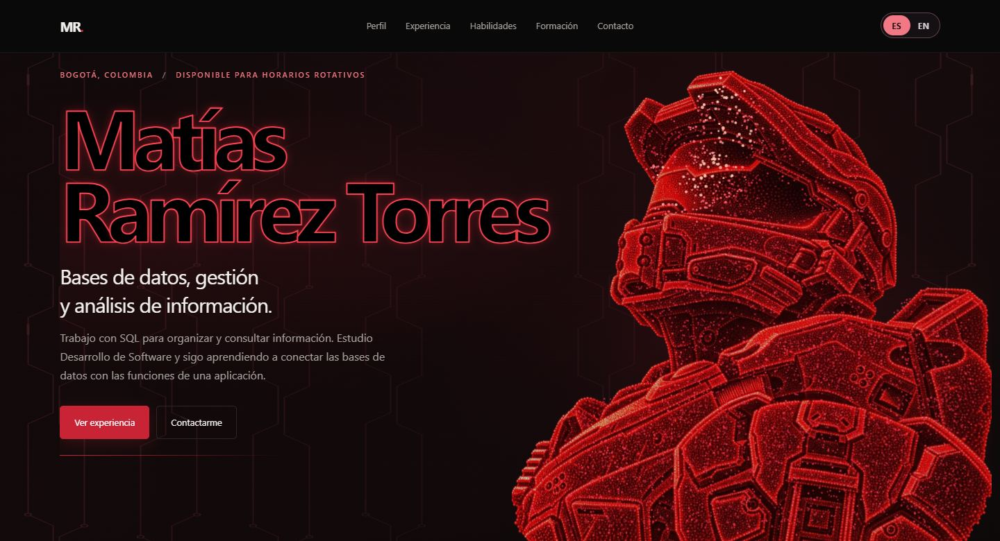

# Matías Ramírez Torres · Analista de Datos y Desarrollador

Portafolio en español e inglés sobre bases de datos, análisis de información y desarrollo backend. Mi experiencia destacada es NeuroLearn IA, proyecto de grado en el que trabajé en la integración de PostgreSQL con Supabase y en la autenticación.

[Visitar el portafolio](https://matiasramirezt.github.io/Mi-portafolio/) · [Explorar el caso SQL](https://matiasramirezt.github.io/Mi-portafolio/#caso-sql) · [Ver mi contribución a NeuroLearn](https://github.com/YesicaCausado/Proyecto_g/commit/0cb81057716737cd7bfaeb126631b646771a3f25)



## Trabajo destacado

- **Análisis SQL.** ¿Qué competencia conviene revisar primero? Una muestra sintética de 80 respuestas permite contrastar el volumen de errores con la tasa de error. Los datos, la consulta y las instrucciones se pueden descargar y reproducir. [Abrir caso](casos/neurolearn/)
- **Desarrollo en equipo.** NeuroLearn IA es una aplicación educativa para preparar el Saber 11. El portafolio reúne el proceso de marzo a noviembre de 2026, tres capturas del producto y una captura independiente del informe de demostración. [Repositorio del equipo](https://github.com/YesicaCausado/Proyecto_g)

## Desarrollo local

El sitio usa HTML, CSS y JavaScript. Desde la raíz, sirve los archivos con Python 3 y abre `http://localhost:8000`.

```sh
python -m http.server 8000 --bind 127.0.0.1
```

Para comprobar los resultados SQL, las traducciones y los enlaces locales:

```sh
python -m unittest discover -s tests
```

## Estructura

| Ruta | Contenido |
| --- | --- |
| `index.html` | Contenido base en español, navegación, galería y formulario de contacto |
| `assets/css/` | Paleta y tipografía, diseño adaptable y efectos de plasma |
| `assets/js/` | Interacción, armadura de partículas, selector de idioma y diccionario inglés |
| `assets/images/` | Retrato, circuitos y capturas |
| `assets/documents/` | Copias públicas de los certificados |
| `casos/neurolearn/` | Muestra sintética, consulta SQL y guía de reproducción |
| `tests/` | Comprobaciones con la biblioteca estándar de Python |

El formulario prepara un borrador en la aplicación de correo del visitante. Las decisiones de [contenido](docs/contenido.md) y [diseño](docs/diseno.md) se documentan por separado.
