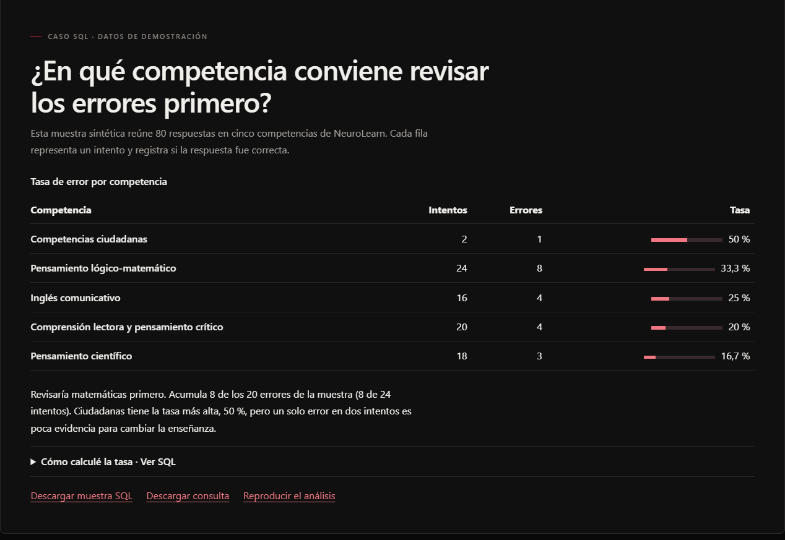

# NeuroLearn IA · Tasa de error por competencia

**Pregunta.** ¿Qué competencia conviene revisar primero al observar los errores de una muestra de respuestas?

**Datos.** 80 respuestas sintéticas distribuidas entre cinco competencias. Cada fila de `respuestas` es un intento, con su competencia y un valor binario de acierto. La muestra sirve para reproducir el análisis y no contiene registros de estudiantes.



## Reproducir con SQLite

Desde la raíz del repositorio, abre una sesión temporal con `sqlite3 :memory:` y ejecuta en la misma sesión:

```text
.headers on
.mode column
.read casos/neurolearn/muestra.sql
.read casos/neurolearn/consulta.sql
```

También puedes verificar los resultados con Python 3, que incluye SQLite:

```sh
python -m unittest discover -s tests
```

## Interpretación

La tasa se calcula como errores divididos entre intentos y se redondea a un decimal. Matemáticas concentra 8 de los 20 errores y alcanza un 33,3 % de error sobre 24 intentos. Ciudadanas llega al 50 %, pero con solo dos intentos. En este ejemplo priorizaría revisar los ejercicios de matemáticas y recoger más observaciones de ciudadanas antes de decidir.

La consulta conserva competencias sin intentos. En ese caso devuelve cero intentos, cero errores y una tasa nula. La unidad analizada es la respuesta, por lo que estos porcentajes no miden el porcentaje de estudiantes con dificultades.
